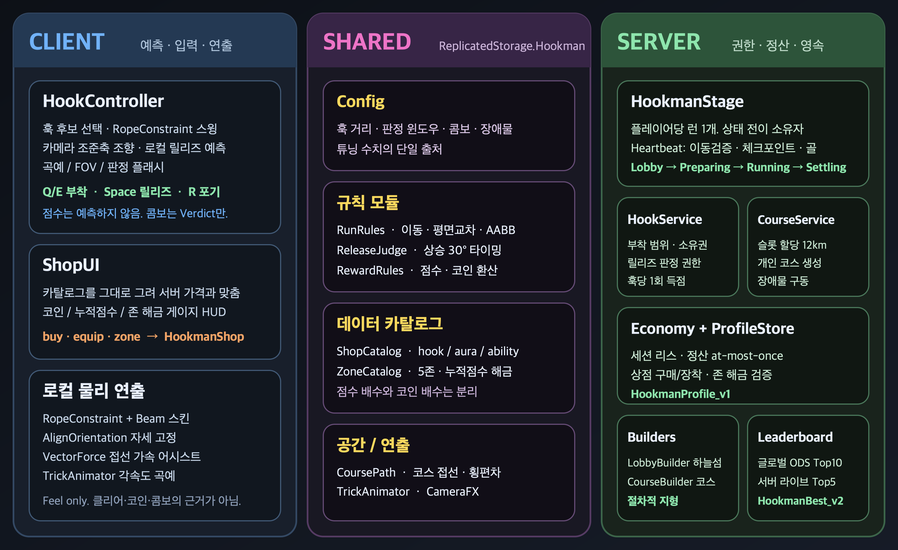
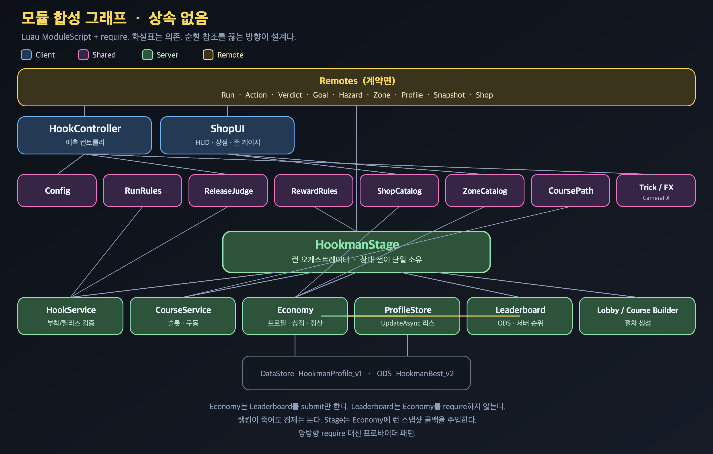
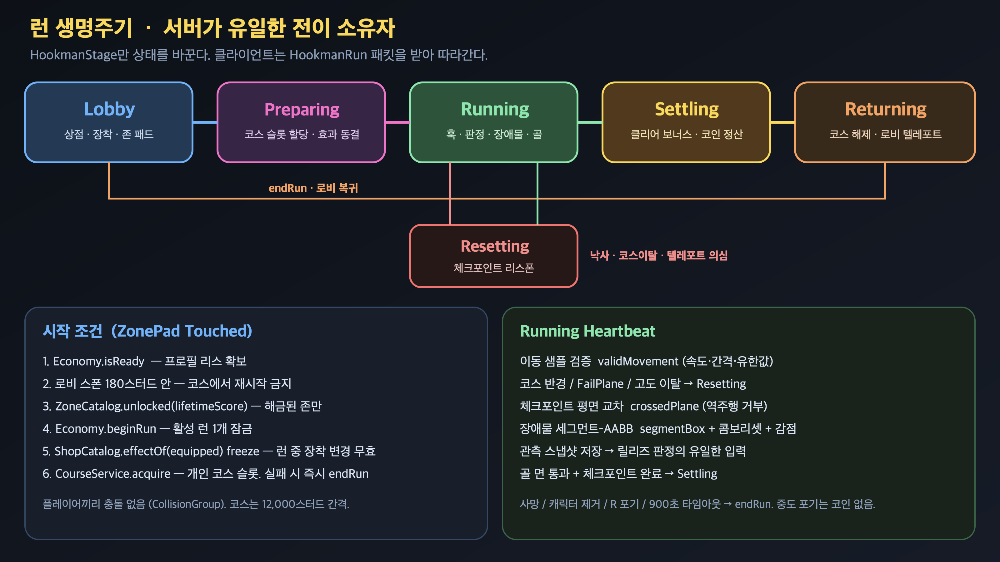
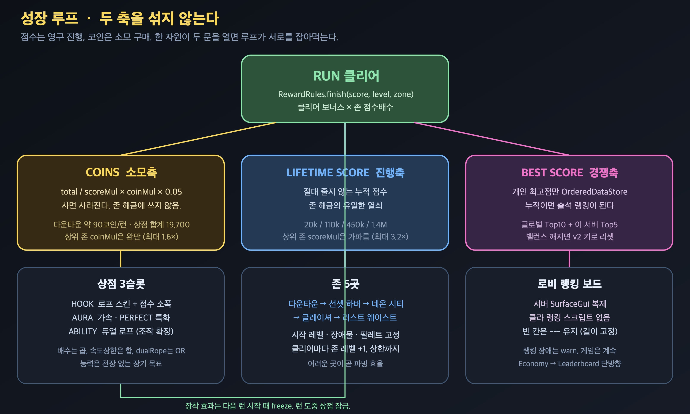
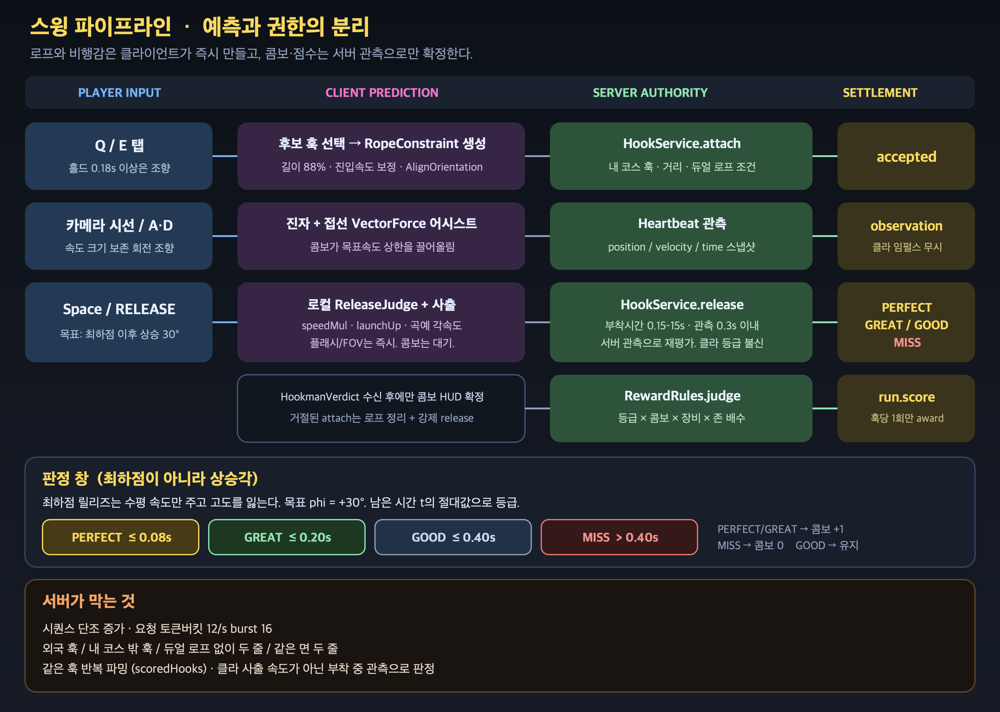

# HOOKMAN

3D 훅 스윙 액션 · 타이밍 판정 · 존 해금 성장

> 로비에서 존을 고르고, 건물 사이 훅을 타고 날아가, 상승 30°에서 손을 놓아 점수를 쌓는다.
> 손맛은 클라이언트가 즉시 만들고, 점수·코인·해금은 서버만 확정한다.

---

## 프로젝트 개요

로비에서 장비를 고르고, 개인 코스를 날아, 상승 타이밍에 손을 놓는 성장형 스윙 러너.

---

## 핵심 구현 및 기능

- **스윙 전투 시스템**
훅 후보 가중 선택, RopeConstraint 진자, 카메라 조준축 조향, 상승 30° 릴리즈
- **판정 파이프라인**
클라 예측 연출 / 서버 관측 재평가, PERFECT–MISS 등급, 콤보 집계, 훅당 1회 득점
- **성장 루프**
누적점수 존 해금, 코인 상점, 최고점 랭킹, 삼축 자원 분리
- **런 오케스트레이션**
서버 권한 상태기계, 플레이어당 런 1개, 개인 코스 슬롯, 체크포인트

---

## 1. 개요

HOOKMAN은 **한 번의 런 = 한 명의 플레이어 = 한 개의 개인 코스**다.

플레이어는 로비에서 훅 스킨·오오라·능력을 장착하고, 해금된 존 패드를 밟아 들어간다. 코스는 레벨이 오를수록 길어지고 꺾이고 장애물이 늘며, 존마다 팔레트가 고정돼 다른 장소로 읽힌다. 건물 옆 훅에 로프를 걸고 진자처럼 가속한 뒤, **최하점이 아니라 상승 30°**에서 손을 놓아 다음 훅으로 날아간다. 골 면을 통과해야만 점수가 코인이 된다. 중간에 떨어지면 체크포인트에서 다시 뜨고, 포기·사망은 코인 없이 로비로 돌아온다.

핵심 설계 결정 세 가지:

1. **손맛과 권한을 나눈다.** 로프·사출·곡예·FOV는 클라가 즉시 만든다. 콤보·점수·클리어는 서버 관측으로만 확정한다.
2. **성장 축을 섞지 않는다.** 누적 점수는 존 해금, 코인은 상점, 최고점은 랭킹. 코인으로 존을 열면 살수록 진행이 멀어진다.
3. **상속 대신 합성.** 공유 모듈이 규칙의 단일 출처고, 서버 모듈은 역할별로 나뉘며, 순환 require는 콜백으로 끊는다.

---

## 2. 구조

이 프로젝트에는 클래스 상속이 없다. 전부 **ModuleScript 합성 + Remote 계약**이다.

### 레이어

| 레이어 | 위치 | 하는 일 | 하지 않는 일 |
| --- | --- | --- | --- |
| Client | `StarterPlayerScripts/Hookman` | 입력, 로프 예측, HUD, 상점 UI | 점수 확정, 해금 판정, 저장 |
| Shared | `ReplicatedStorage/Hookman` | 수치·규칙·카탈로그·경로 식 | 월드 소유, DataStore |
| Server | `ServerScriptService` | 런 전이, 검증, 정산, 코스 할당 | 로프 연출, 카메라 |
| Persist | DataStore / ODS | 프로필 리스, 최고점 순위 | 게임플레이 |

클라이언트는 서버 모듈을 require하지 않는다. 서버는 클라이언트를 호출하지 않고 Remote로만 밀어준다. 공유 모듈은 양쪽이 같은 식을 쓰기 위한 계약이다.

순환을 끊는 방향:

- `Economy` → `Leaderboard.submit` 단방향. 랭킹이 죽어도 경제는 돈다.
- `HookmanStage`는 Economy에 **런 스냅샷 프로바이더**를 주입한다. 양방향 require 대신 콜백.
- `CoursePath`는 전역 워크스페이스 조회가 아니라 **그 코스 인스턴스의 PathNodes**에 묶인다.

---

## 3. 설계

### 3-1. 권한 모델

클라가 점수를 계산해 올리면 끝장이다. 반대로 매 프레임 물리까지 서버가 돌리면 스윙 손맛이 죽는다.

타협:

| 항목 | 주인 |
| --- | --- |
| 로프 생성, 빔 스킨, 접선 가속, 곡예 각속도, FOV | Client |
| 훅 소유권, 부착 거리, 듀얼 로프 자격, 릴리즈 등급 | Server |
| 콤보, 런 점수, 코인, 존 해금, 최고점 | Server |
| 판정 공식 자체 (`ReleaseJudge`, `RewardRules`) | Shared |

릴리즈 때 클라는 자기 속도로 사출하고 플래시를 띄운다. 서버는 **클라가 보낸 속도가 아니라 Heartbeat에 쌓아 둔 부착 중 관측**으로 다시 판정한다. 콤보 HUD는 `HookmanVerdict`가 오기 전에 확정하지 않는다.

### 3-2. 런은 상태기계 하나

`HookmanStage`만 상태를 바꾼다. 클라는 `HookmanRun` 패킷을 받아 따라간다.

시작은 존 패드 Touched다. 조건이 하나라도 빠지면 들어가지 못한다.

- 프로필 리스가 살아 있을 것
- 로비 스폰 180스터드 안일 것 (코스에서 재시작 금지)
- 누적 점수로 해금된 존일 것
- 활성 런이 없을 것
- 장착 효과를 freeze할 것 (런 중 상점 잠금)
- 개인 코스 슬롯을 잡을 것 (실패 시 즉시 로비)

Running 루프는 이동 샘플을 검증하고, 코스 반경·낙하면을 보고, 체크포인트 평면을 **앞으로 통과했는지** 확인하고, 장애물은 샘플 사이 얇은 막대까지 잡도록 선분–AABB로 친다. 골은 착지 패드가 아니라 코스를 가로막는 결승 면이다.

Resetting은 런을 끝내지 않는다. 체크포인트(없으면 스타트)로 되돌리고 무적 시간을 준다. 사망·R 포기·900초 타임아웃만 Returning이다. 중도 포기는 코인이 없다 — 안 그러면 상점만 채우고 코스는 안 미는 플레이가 최적이 된다.

### 3-3. 성장은 세 숫자

| 숫자 | 늘면 | 줄면 | 쓰는 곳 |
| --- | --- | --- | --- |
| `lifetimeScore` | 클리어마다 가산 | 절대 안 줄음 | 존 해금 |
| `coins` | 클리어 환산 | 상점 구매 | hook / aura / ability |
| `bestScore` | 개인 최고만 | 안 줄음 | 글로벌·서버 랭킹 |

존 점수 배수(`scoreMul`)는 최대 3.2배로 가파르다. 어려운 곳이 곧 파밍 효율이다. 코인 배수(`coinMul`)는 최대 1.6배로 완만하다. 예전에 코인도 `scoreMul`을 먹었더니 상위 존 10런 만에 상점이 죽었다.

장비는 ScriptableObject가 아니라 **공유 카탈로그 테이블**이다. UI와 서버가 같은 가격·효과를 본다.

- **HOOK** — 로프 외형 + 점수 소폭
- **AURA** — 접선 가속, PERFECT 특화
- **ABILITY** — 듀얼 로프. 배수는 천장에 닿지만 능력은 “할 수 있는 것”이 늘어 장기 목표가 된다

효과 합성: 배수는 곱, 속도 상한은 합, `dualRope`는 OR. 런 시작 때 freeze하므로 도중 교체는 다음 런부터다.

존 5곳: 다운타운 → 선셋 하버 → 네온 시티 → 글레이셔 → 러스트 웨이스트. 해금 곡선은 중급 장비 기준 대략 9 / 25 / 52 / 92 클리어.

### 3-4. 영속은 리스

프로필은 `UpdateAsync`만 탄다. 세션 토큰 + `jobId` + 만료(120초)가 리스다.

- 만료 전 다른 서버는 못 훔친다
- 만료된 세션은 새 주인 위에 저장하지 못한다
- 획득이 취소되면 **자기 토큰만** 지운다. 기존 데이터를 덮지 않는다
- 정산은 datastore yield 전에 `settled = true`. 같은 런을 두 번 지급하지 않는다
- 리스를 잃으면 킥한다. 조용히 로컬만 굴리면 기록이 갈린다

랭킹은 별도 OrderedDataStore `HookmanBest_v2`. 최고점만 올린다. 누적이면 출석 랭킹, 런마다면 순위가 의미를 잃는다. 밸런스가 바뀌면 키를 올린다 — 콤보 상한 3.0과 4.0은 다른 게임의 숫자다.

---

## 4. 기능 · 파이프라인

### 4-1. 스윙 한 사이클

1. **Q/E 탭** — 전방 각도·거리·반대면 가중으로 훅을 고른다. 지상에 발이 붙어 있으면 막는다 (장력이 몸을 못 들어 랙돌이 눕는다). 0.18초 이상 홀드는 조향.
2. **예측 부착** — 실제 거리의 88%로 RopeConstraint. AlignOrientation으로 자세 고정. VectorForce로 접선 에너지를 보충한다. 안 넣으면 2~3회 만에 속도가 죽는다.
3. **서버 attach** — 내 코스 훅인지, 거리, 이미 한 줄이 있는지, 듀얼 로프 자격이 있는지. 거절되면 클라는 로프를 걷고 강제 release.
4. **스윙** — 속도 크기는 보존한 채 수평 방향만 시선 쪽으로 회전시킨다. 힘으로 밀면 로프 장력이 먹는다.
5. **릴리즈** — 목표 상승각 30°. 로컬은 사출·곡예·플래시를 즉시 하고, 서버는 관측으로 재평가.
6. **정산** — 신선 훅만 점수. PERFECT/GREAT는 콤보+1, MISS는 0, GOOD은 유지. 콤보 배수 상한 4.0 (약 30콤보).

판정 창:

| 등급 | \|t\| | 속도 | 상승 | 콤보 |
| --- | --- | --- | --- | --- |
| PERFECT | ≤ 0.08s | ×1.25 | 78 | +1 |
| GREAT | ≤ 0.20s | ×1.10 | 62 | +1 |
| GOOD | ≤ 0.40s | ×1.00 | 46 | 유지 |
| MISS | > 0.40s | ×0.85 | 22 | 0 |

최하점 릴리즈는 수평 속도만 주고 고도를 잃는다. 그래서 목표를 상승 국면으로 옮겼다.

### 4-2. 서버가 막는 것

- 요청 시퀀스 단조 증가, 토큰버킷 12/s · burst 16
- 외국 훅, 코스 밖 훅, 듀얼 없이 두 줄, 같은 면 두 줄
- 같은 훅 반복 파밍 (`scoredHooks`)
- 클라 사출 임펄스로 판정하기 — 부착 중 관측만
- 텔레포트·무한대 속도·샘플 공백 → Resetting
- 런 중 상점·존 변경
- 골 역주행 (평면 교차는 앞으로만)

### 4-3. 월드

`CourseBuilder`가 레벨과 존 팔레트로 코스를 통째로 짓는다. 행마다 확률적으로 꺾고, Sweeper/Spinner/Bobber/게이트를 심고, 훅은 좌우 교대, 골은 낙하 고도부터 훅 고도까지 덮는 면이다.

`CourseService`는 플레이어 수만큼 슬롯을 잡고 12,000스터드 간격으로 민다. 경로 객체는 그 폴더에만 묶이므로 옆 사람 기하를 읽지 않는다. 캐릭터끼리 충돌 그룹이 꺼져 있다.

로비는 코스 원점과 분리된 하늘섬이다. 코스를 재생성할 때 같이 날아가지 않는다. 랭킹 보드는 서버 SurfaceGui라 전 클라가 같은 표를 본다.

### 4-4. 원격 계약

| Remote | 방향 | 내용 |
| --- | --- | --- |
| `HookmanRun` | S→C | 상태, 코스 폴더, 레벨, 존, 체크포인트 |
| `HookmanAction` | C→S | attach / release / abandon + sequence |
| `HookmanVerdict` | S→C | accepted, grade, combo, reason |
| `HookmanGoal` | S→C | 클리어 시간, 점수, 코인 |
| `HookmanHazard` | S→C | 피격 연출 |
| `HookmanZone` | S→C | 미해금 거부 |
| `HookmanProfile` | S→C | 코인, 소유, 장착, 누적, 랭크 |
| `HookmanSnapshot` | C↔S | 재접속 스냅샷 |
| `HookmanShop` | C↔S | buy / equip / zone |

---

## 5. 포트폴리오에 쓸 문장

이력서 한 줄:

> Roblox 훅 스윙 액션의 서버 권한 런타임 — 클라 예측 스윙과 서버 관측 판정을 분리하고, 개인 코스 인스턴스·리스 기반 프로필·점수/코인 이축 성장을 설계·구현.

자기소개서 세 줄:

> 스윙 손맛을 위해 로프와 사출은 클라이언트 예측으로 두고, 콤보와 점수는 서버 Heartbeat 관측으로만 확정했다. 같은 훅 파밍, 외국 훅, 텔레포트, 클라 사출 속도 위조를 이 경계에서 막는다.
>
> 성장 자원을 세 개로 쪼갰다. 누적 점수는 존 해금, 코인은 상점, 최고점은 랭킹. 한 숫자가 두 문을 열면 루프가 서로를 잡아먹는다.
>
> 프로필은 UpdateAsync 세션 리스로만 쓴다. 만료된 세션은 새 주인 위에 저장하지 못하고, 클리어 정산은 yield 전에 at-most-once로 잠근다.

면접에서 꺼낼 결정:

1. 왜 최하점이 아니라 상승 30°인가
2. 왜 점수 배수와 코인 배수를 나눴는가
3. 왜 Economy가 Leaderboard를 require하고 반대는 없는가
4. 왜 코스를 공유하지 않고 슬롯으로 복제하는가
5. 왜 클라 릴리즈 속도가 아니라 부착 중 관측으로 판정하는가

---

## 그림 파일

Notion에 붙일 때 아래 PNG를 이미지 블록으로 넣으면 된다. SVG는 원본.

| 파일 | 내용 |
| --- | --- |
| `images/01-architecture.png` | 클라 / 공유 / 서버 런타임 구조 |
| `images/02-run-lifecycle.png` | 런 상태기계 |
| `images/03-swing-authority.png` | 예측 vs 권한 스윙 파이프라인 |
| `images/04-growth-loop.png` | 점수·코인·랭킹 이축 성장 |
| `images/05-module-graph.png` | require 합성 그래프 |

경로: `docs/portfolio/`
